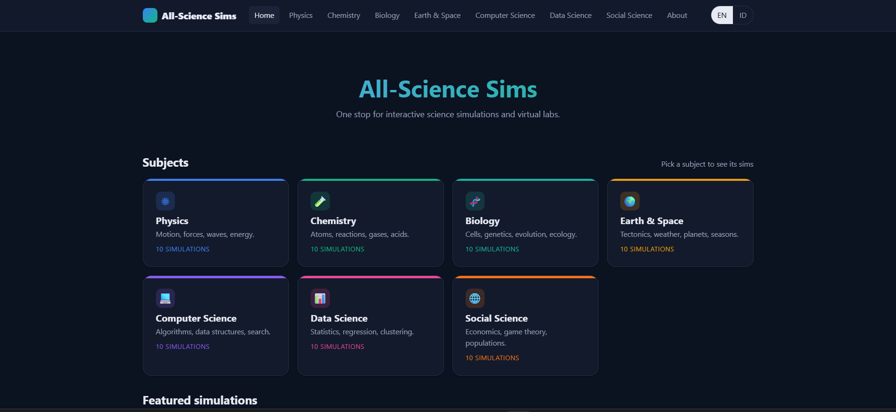
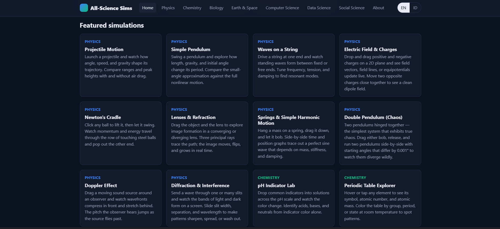
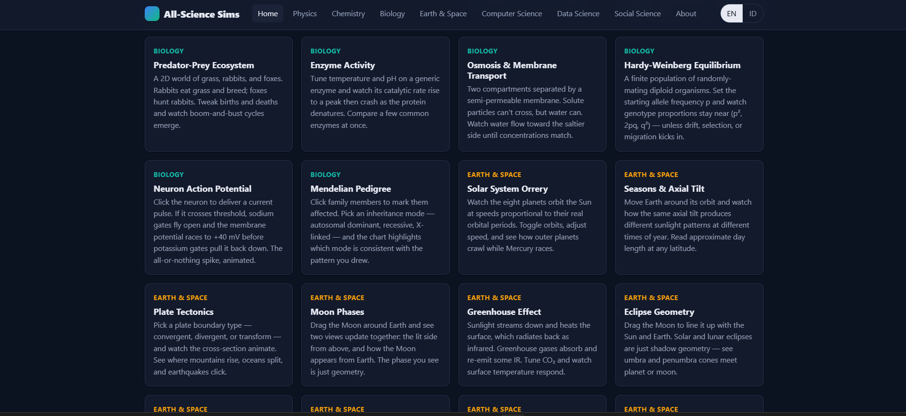
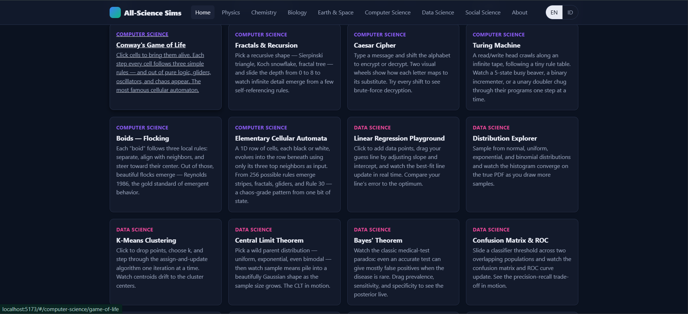
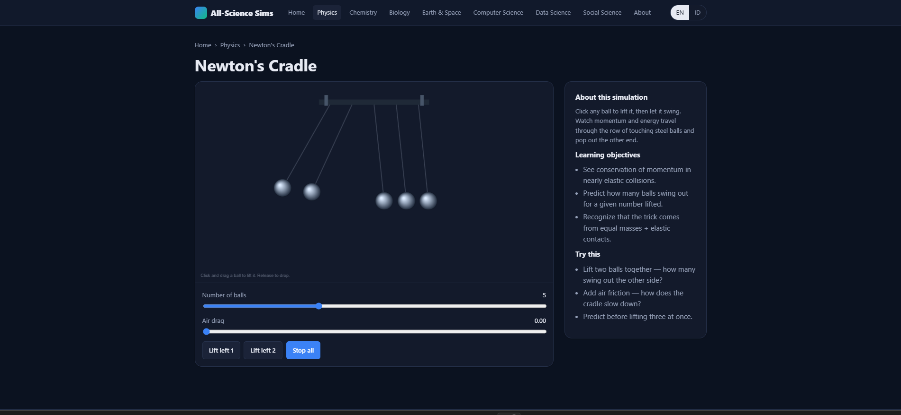
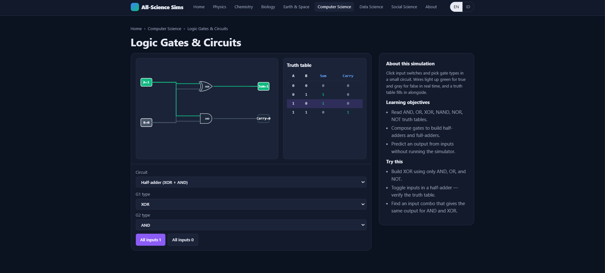
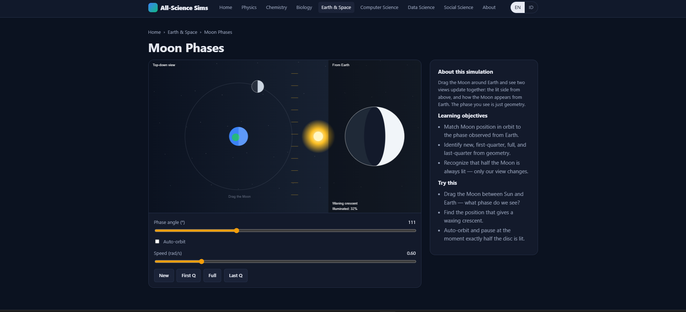
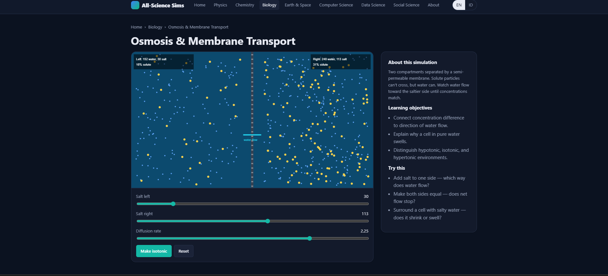

# All-Science Sims

> One stop for interactive science simulations and virtual labs.
> 375 hand-built sims across 14 subjects · runs entirely in your browser · bilingual (English / Bahasa Indonesia) · free for non-commercial use.

A client-side hub of original interactive simulations covering **physics, chemistry, biology, earth & space, computer science, data science, social science, mathematics, finance & economics, engineering, music & acoustics, climate & sustainability, psychology, and cognitive science**. No backend, no tracking, no install — just open the page and start clicking, dragging, and learning. Useful for students, teachers, self-learners, tutors, and anyone curious about science.

See [CHANGELOG.md](CHANGELOG.md) for what's new in each release.

---

## Features

- **375 original simulations** across 14 subjects — see [Catalog](#catalog) below.
- **Direct manipulation everywhere** — drag charges, drag the pendulum bob, drag data points, draw walls in the maze, click switches in a logic circuit, and so on.
- **Bilingual UI**: every sim has English and Bahasa Indonesia text. Toggle in the header; preference is saved to `localStorage`.
- **Fully client-side** — no servers, no APIs, no analytics. Loads fast, works offline once cached, runs from `file://` if you want.
- **Every sim labelled by school level** — a suggested grade range on each card and page, and Primary / Middle / High school / University filter chips on the home and subject pages. See [By school level](#by-school-level) and the [curriculum map](docs/curriculum-map.md).
- **Learn more on every sim** — the science behind it in plain language, an explanatory diagram, key ideas, vocabulary, common misconceptions, real-world connections, and check-yourself questions, pitched to the sim's grade range, in both languages.
- **Real Python in the browser** — the programming sims run the Python taught in school (variables, control flow, functions, lists, dictionaries; no classes) step by step in a built-in interpreter (`src/lib/minipy.js`), checked against CPython 3.13 for output, error messages and tracebacks, with `turtle` and `matplotlib.pyplot` drawn on the page. No install, no server, works offline.
- **Virtual labs** — many sims carry a lab panel: follow a procedure, make a prediction, record measurements into a table, export CSV. Data auto-saves on the device.
- **Deep links and embedding** — every control has a URL key, so `#/physics/pendulum?length-m=2` opens the sim preset. `#/embed/...` gives a stage-only view for an `<iframe>` in any LMS or blog. See [Sharing, deep links, and embedding](#sharing-deep-links-and-embedding).
- **Touch and keyboard friendly** — pointer events everywhere, so dragging works on phones and tablets; every drag handle is reachable with Tab and nudged with the arrow keys.
- **Lazy-loaded sims** — the home page ships the catalog and shared code (about 140 KB gzipped); each sim's code and long-form text download only when opened.
- **Hash-based routing** — the same `dist/` folder works on GitHub Pages, Netlify, Vercel, S3, your own server, or a USB stick.
- **Responsive + dark-mode aware** — adapts to your OS theme via `prefers-color-scheme`.
- **Reduced-motion respect** — non-essential animations slow down for `prefers-reduced-motion: reduce`.
- **Tested** — a Playwright smoke test opens every sim on every push (see [Testing](#testing)).

---

## Screenshots

**Home page** — pick a subject from the grid, or scroll down for featured sims.



**Featured simulations** — every sim is one click away from the front page.



**Subject pages** — each subject collects its sims in one place.

| Biology · Earth & Space | Computer Science |
|:---:|:---:|
|  |  |

**Sim pages** — every sim has the same layout: interactive stage on the left, intro / objectives / "try this" prompts on the right.

| Newton's Cradle (Physics) | Logic Gates & Circuits (CS) |
|:---:|:---:|
|  |  |

| Moon Phases (Earth & Space) | Osmosis & Membrane Transport (Biology) |
|:---:|:---:|
|  |  |

---

## By school level

Each manifest carries `grade: [...]` (school years 1–12, 13 = university), assigned against NGSS, the national curriculum for England, and Kurikulum Merdeka. The home and subject pages filter by level; the badge on each sim shows its range. [docs/curriculum-map.md](docs/curriculum-map.md) lists every sim by level with the closest standards families.

| Level | Typical frameworks | Sims |
|---|---|---|
| Primary (grades 1–6) | NGSS K-5 · KS1–KS2 · Merdeka Fase A–C (IPAS) | 63 |
| Middle school (grades 7–9) | NGSS 6-8 · KS3 · Merdeka Fase D | 145 |
| High school (grades 10–12) | NGSS 9-12 · KS4, A-level, IB · Merdeka Fase E–F | 276 |
| University | Undergraduate courses | 119 |

Counts overlap because many sims span two levels. Primary sims use big controls, plain words, and predict-then-test flows; see for example Float or Sink?, Magnets, Light the Bulb, Grow a Plant, and Day and Night.

---

## Catalog

### Physics

| Sim | What you do |
|---|---|
| Projectile Motion | Click anywhere on the field to aim the launcher. Adjust angle, speed, gravity, and air drag; compare ranges with ghost trails. |
| Simple Pendulum | Grab and drag the bob to set the initial angle. Compare measured period vs. small-angle prediction. |
| Waves on a String | Drive a string at one end, choose fixed/free far end, find resonant frequencies. |
| Electric Field & Charges | Drop, drag, and right-click charges. Toggle field lines, vector grid, or potential heatmap. |
| Newton's Cradle | Click and lift any of N balls, release, watch momentum cascade through the row. |
| Lenses & Refraction | Drag the object along the axis; three principal rays trace image formation in a converging or diverging lens. |
| Springs & SHM | Hang a mass on a spring, drag and release; side-by-side time/position graph shows perfect sine motion. |
| Double Pendulum (chaos) | Two pendulums hinged together — drag a bob, release, watch a "ghost" pendulum perturbed by 0.001° diverge wildly. |
| Doppler Effect | Drag a moving sound source past an observer; wavefronts bunch in front and stretch behind, plus a Mach cone above the speed of sound. |
| Diffraction & Interference | 1–8 slits, slide width / spacing / wavelength; intensity profile and screen pattern update live. |
| Buoyancy & Archimedes | Drop blocks of any density into water, oil, mercury, glycerin; the submerged fraction equals density ratio. |
| Orbital Mechanics (Kepler) | Click to place a planet, drag to set velocity, release; circular, elliptical, or escape trajectories emerge. |
| RLC Circuit Resonance | Series RLC schematic with animated current; current-vs-frequency curve peaks sharply at f₀ = 1/(2π√(LC)). |
| 1D Collisions | Two carts with adjustable masses and velocities; tune restitution from elastic to perfectly sticky. |
| Carnot Heat Engine | P-V diagram with two isotherms + two adiabats; efficiency η = 1 − T_c / T_h. |
| Snell's Law (Refraction) | Drag the incident ray; refracted ray bends per n₁sinθ₁ = n₂sinθ₂; total internal reflection beyond critical angle. |
| Magnetic Field around a Wire | Field circles around the wire by the right-hand rule; cursor probes B = μ₀I/(2πr). |
| Photoelectric Effect | Below threshold frequency no electrons fly, no matter how bright. Above it, KE_max = hf − φ. |
| Springs & Simple Harmonic Motion | Hang a mass on a spring, drag it down, and let it bob. |
| Double Pendulum (Chaos) | Two pendulums hinged together — the simplest system that exhibits true chaos. |
| Inclined Plane with Friction | A block on a ramp. |
| Hooke's Law | Hang a weight on a spring; the spring stretches a distance proportional to the force. |
| Atwood Machine | Two masses on a string over a frictionless pulley — the textbook setup for Newton's second law applied to a system. |
| Curved Mirrors | A concave or convex mirror with a candle as the object. |
| Bernoulli's Principle | A pipe narrows in the middle — the fluid speeds up to maintain volume flow, and pressure drops. |
| Series & Parallel Circuits | Three light bulbs, a battery, switches you can flip. |
| Float or Sink? | Pick an object from the shelf. |
| Push the Car: Friction | Give a toy car a small, medium or big push and watch how far it rolls. |
| Energy Transfers | Reshape a roller-coaster track by dragging its control points, then release a cart from a chosen height. |
| Build an Electromagnet | Wind a coil around a core, connect a battery pack and flip the switch. |
| Light the Bulb | A battery, a bulb, a switch and wires on a board. |
| Light and Shadows | Drag a torch around a toy and watch its shadow on the wall. |
| Sound is Vibration | Hit a drum, pluck a guitar string or tap a tuning fork and watch it wobble. |
| Magnets | Drag two bar magnets around. |
| Heat Transfer | Three ways heat moves. |
| Speed, Distance and Time | Set the speed of a vehicle on a straight 200 m track, press Start and watch the stopwatch run while distance–time and speed–time graphs draw themselves. |
| Energy Roller Coaster | Shape a roller-coaster track by dragging six control points, place the cart at any height and release it. |
| Sound Travels | Ring a bell and watch the sound travel to an ear 1 km away. |
| Wave Anatomy | A transverse wave on a rope and a longitudinal wave in a spring run side by side from the same source. |
| The Bent Straw | Put a straw in a glass and pour in water. |
| Moving Magnet, Flowing Current | Push a bar magnet through a coil of wire and watch a galvanometer needle kick one way as it enters and the other way as it leaves. |
| Energy Chain | Energy never disappears, it just changes form. |
| The Eye and Corrective Lenses | Look inside an eye as it tries to focus light from an object onto the retina. |
| Push, Pull, Squash! | A ball, a toy car and a lump of clay sit on a table. |
| Which Spoon Gets Hot? | Three spoons stand in a cup of hot water: one metal, one wood, one plastic. |
| Hydraulic Lift | Push on a small piston and watch a large piston lift a heavy load. |
| Levers: Tools and the Body | Pick a crowbar, a wheelbarrow, a pair of tweezers or your own forearm, and drag the point where the effort pushes. |
| Pressure and Depth | Punch three holes in a tall bottle and watch the water jets: the deepest hole squirts the farthest. |
| Measure It! | Read a virtual ruler, a vernier caliper and a dial balance. |
| Mirror Game | A torch shines a beam of light across the room. |
| Motion Graphs | Drive a car along a straight road with a velocity slider, or pick a preset: constant speed, speeding up, slowing down or stop-and-go. |
| Force, Mass, Acceleration | Push a cart along a 12 m track with a force you choose (0–50 N), change its mass (1–10 kg) and switch friction on or off. |
| Pressure: Pins and Snowshoes | Press the same weight into sand through a pin tip, a stiletto heel, a flat shoe or a snowshoe and watch how deep each one sinks. |
| Seesaw Balance | A seesaw with a weight on each side. |
| Static Electricity | Rub a balloon on wool or a glass rod on silk and watch electrons jump from one to the other. |
| Thermal Expansion | Heat a steel rail, a metal ball next to a ring, or a steel-brass bimetal strip from 0 to 300 °C and watch them grow. |
| Fission and Fusion | Explore the binding energy per nucleon curve built from real atomic masses of about 40 nuclides, click any point to see its Z, N and BE/A, and discover why iron-56 and nickel-62 sit at the top. |
| AC Generator | Spin a rectangular coil between the poles of a magnet and watch the flux Φ = NBA cos ωt and the induced EMF ε = NBAω sin ωt drawn live, while a bulb on the slip rings flickers with |ε|. |
| Analog to Digital | Turn a smooth analog signal into numbers: choose a sine, a voice-like mix of harmonics or a triangle wave, sample it at a rate you set and quantise each sample to 1–8 bits. |
| Blackbody Radiation | Heat an ideal emitter from 300 K to 10 000 K and watch its Planck spectrum change shape: the peak slides to shorter wavelengths following Wien's law λ_max = b/T while the area under the curve, the radiated power per square metre σT⁴, explodes. |
| Parallel-Plate Capacitor | Build a parallel-plate capacitor: set the plate area, the gap and the dielectric (air, paper, glass or water) and read C = κε₀A/d in picofarads. |
| Young's Double Slit | Shine monochromatic light of a chosen wavelength through two narrow slits and watch the interference fringes build up on a screen, column by column, from the real intensity formula. |
| Charge in a Magnetic Field | Fire an electron, a proton, an alpha particle or a custom charge into a uniform magnetic field pointing into or out of the page and watch it bend into a circle of radius r = mv/(qB). |
| Time Dilation and Length Contraction | Watch a light clock on a spaceship from two points of view at once: in the ship frame the light bounces straight up and down, while from the ground the same light travels a longer zigzag at the same speed c, so the moving clock ticks slower by the factor γ = 1/√(1 − v²/c²). |
| Coulomb's Law | Set two point charges between −10 and +10 μC, drag one along the line to change their separation, and watch the electrostatic force vectors stretch and flip as F = k·q₁q₂/r². |
| Standing Waves in Pipes and Strings | Set up a standing wave in an open–open pipe, an open–closed pipe or a string fixed at both ends. |

### Chemistry

| Sim | What you do |
|---|---|
| pH Indicator Lab | Pick an indicator and a pH preset (lemon juice, vinegar, soap…) and see the beaker color flip. |
| Periodic Table Explorer | Hover any of the 118 elements; color the table by category, state at 25 °C, or period. |
| Ideal Gas Law | Tune n, T, and V; watch particles bounce while pressure (collision rate) responds as PV = nRT predicts. |
| Acid-Base Titration | Drip NaOH into strong or weak acid; the pH curve traces out and the indicator color changes in real time. |
| Bohr Atom Model | Slide atomic number Z; electrons fill 2-8-8-18 shells around the nucleus, valence highlighted. |
| Le Chatelier's Principle | Pick a reversible reaction (Haber, Contact, generic), then perturb T, P, or reagents and watch equilibrium shift. |
| Solubility & Saturation | Spoon solute into water; up to a temperature-dependent limit it dissolves, then deposits at the bottom. |
| VSEPR Molecular Geometry | Pick bonded atoms + lone pairs; the 3D shape rearranges (linear, tetrahedral, trigonal bipyramid, octahedral, plus presets like H₂O, NH₃, SF₆). |
| Phase Diagram (Water) | Drag a marker on the P-T plane; sample becomes solid / liquid / gas / supercritical with triple and critical points marked. |
| Beer-Lambert Spectroscopy | Slide concentration, path length, and wavelength; live transmittance, full absorbance spectrum, and a tunable lamp-cuvette-detector. |
| Collision Theory & Reaction Rates | Two species bouncing in a box; only collisions above Eₐ react. Rate responds to T, [A], [B], and a "catalyst" button. |
| Radioactive Decay & Half-Life | A grid of unstable atoms; each frame each one has a tiny chance to decay. Watch population halve every T₁⁄₂. |
| Aufbau Principle | Slide Z; electrons fill orbitals 1s, 2s, 2p, 3s, 3p, 4s, 3d… following Aufbau, Hund, Pauli; box diagram + configuration string. |
| Galvanic Cell | Pick two metal electrodes; cell voltage and electron-flow direction emerge from standard reduction potentials. |
| Buffer pH (Henderson-Hasselbalch) | Slide [HA], [A⁻], pKa; pH curve vs added acid/base shows the buffer's resilience zone. |
| Crystal Lattices | Rotatable 3D unit cells: simple cubic, BCC, FCC, HCP, with coordination # and packing fraction. |
| Hybridization (sp / sp² / sp³) | Linear / trigonal-planar / tetrahedral geometries with bond angles and worked examples. |
| Galvanic Cell (Battery) | Two metal half-cells joined by a salt bridge. |
| Crystal Lattices (BCC, FCC, HCP) | A unit cell rendered in 3D — drag to rotate. |
| Hybridization (sp, sp², sp³) | Carbon's atomic orbitals mix to form hybrid orbitals — sp (linear), sp² (trigonal planar), or sp³ (tetrahedral). |
| Stoichiometry & Limiting Reagent | Pick a reaction, set how much of each reactant you have, and watch the kitchen-style block diagram show which one runs out first — the limiting reagent. |
| Calorimetry | Drop a hot metal block into a cup of cool water and watch the temperatures equilibrate. |
| Electrolysis of Water | Pass electric current through water and watch hydrogen bubble up at the cathode and oxygen at the anode in a 2:1 volume ratio. |
| Atomic Emission Spectra | Heat a gas and it glows in a few specific colors — the "fingerprint" of its element. |
| Activation Energy & Catalysis | Drag the energy diagram to set the activation barrier and the heat of reaction. |
| Separating Mixtures | Choose a mixture such as sand and water, salt and water or ink dyes, then try to separate it by filtering, evaporating, distilling, chromatography, a magnet or decanting. |
| Physical or Chemical Change? | Sort ten everyday changes, from ice melting to paper burning, into physical or chemical. |
| Ice, Water, Steam | Heat or cool a box of tiny particles and watch them change. |
| Density Lab | Drag blocks of wood, ice, plastic, aluminium, iron, gold, cork and a mystery material onto a balance to read their mass, then into a measuring cylinder to find their volume from the water that rises. |
| Particle Model of Matter | Particles in a box with a movable piston. |
| Food Label Detective | Pick a packaged snack or drink and read its ingredient list like a detective. |
| Dissolve It! | Drop a spoonful of sugar, salt, sand, flour or oil into a glass of water and watch what happens. |
| Electrolytes and Conductivity | Lower a conductivity tester into a beaker of NaCl, HCl, NaOH, acetic acid, ammonia, sugar, ethanol or pure water and set the concentration. |
| Hydrocarbon Builder | Click grid positions to build a carbon chain of 1–8 atoms, cycle each C–C bond through single, double and triple, and hang methyl branches above or below the chain. |
| Ionic or Covalent? | Pick any two elements from a mini periodic table and watch what their valence electrons do: jump across to make ions and a crystal lattice, get shared in a Lewis-dot overlap, or pool into a sea of electrons between metal cations. |
| Colligative Properties | Dissolve sucrose, ethylene glycol, table salt or calcium chloride in water and read how the boiling point rises, the freezing point falls, the vapour pressure drops and the osmotic pressure builds, all in proportion to i × molality. |
| Enthalpy Diagrams and Hess's Law | Build a reaction pathway by dragging step reactions into a cycle, flipping any that run the wrong way, and watch the enthalpy level diagram add the ΔH values until the steps match the target reaction. |
| Intermolecular Forces and Boiling Points | Choose a molecule (alkanes, hydrogen halides, water, ammonia, HF, methanol, CO₂, neon, argon) and heat it with a temperature slider. |
| Lewis Structure Builder | Choose a molecule (H₂O, CO₂, NH₃, CH₄, O₂, N₂, HCl, SO₂, BF₃ or PCl₅) and build its Lewis structure yourself: click between two atoms to add single, double or triple bonds and click an atom to add lone pairs. |
| Limiting Reagent | Choose a balanced reaction, dial in the moles of each reactant and press React: the particle boxes show which reactant runs out first and what is left over. |
| Molarity and Dilution | Weigh out a solute (table salt, glucose or blue copper(II) sulfate), dissolve it in a volumetric flask of 100 to 1000 mL and read the molarity M = n/V as the colour and particle density change. |

### Biology

| Sim | What you do |
|---|---|
| Punnett Square | Cross monohybrid (Aa × Aa) and dihybrid (AaBb × AaBb) parents; ratios fill in automatically. |
| Cell Explorer | Click any organelle in an animal or plant cell to see what it does. |
| Natural Selection | Color-camouflaged prey reproduce on a colored background; the population shifts toward camouflaging hues. |
| DNA Transcription & Translation | Type any DNA, watch RNA polymerase + ribosome walk it base-by-base into a polypeptide. |
| Predator-Prey Ecosystem | 2D world of grass, rabbits, foxes — boom-and-bust population cycles emerge. |
| Enzyme Activity | Tune T and pH on pepsin, trypsin, amylase, catalase; activity curves shift; denaturation past 55 °C. |
| Osmosis & Membrane Transport | Two compartments, semi-permeable membrane — water flows toward the saltier side. |
| Hardy-Weinberg Equilibrium | Diploid population, set N and p; observe drift in small populations and selection shifting allele frequency. |
| Neuron Action Potential | Click the neuron to fire a pulse; FitzHugh-Nagumo dynamics show threshold, depolarization, refractory period. |
| Mendelian Pedigree | 3-generation family chart; click anyone to mark affected, and the panel says which inheritance modes are consistent. |
| Photosynthesis Rate | Tune light, CO₂, and temperature; bubbles of O₂ rise from a virtual leaf at the rate set by the limiting factor. |
| ECG / Heart Rhythm | Live P-QRS-T trace with a beating schematic heart; presets for resting, sleep, sprint, bradycardia, missed beats. |
| Mitosis Stages | Step or auto-play through interphase → prophase → metaphase → anaphase → telophase → cytokinesis. |
| DNA Replication | Replication fork unzips template; leading strand smooth, lagging strand built in Okazaki fragments. |
| Cellular Respiration | Step through glycolysis → Krebs → ETC; running ATP, NADH, FADH₂, CO₂, O₂ counts. |
| Epidemic on a Network | Force-directed network with SIR spread along edges; compares structure to well-mixed SIR. |
| Population Pyramid | 5-year age groups, male/female; demographic-transition presets (Niger, US, Japan). |
| Interactive Cell Explorer | Switch between an animal and plant cell and click each organelle to see what it does. |
| DNA Replication (Replication Fork) | A replication fork unzips the DNA double helix; the leading strand copies smoothly while the lagging strand has to be assembled in Okazaki fragments. |
| Cardiac Cycle | A schematic heart pumps in real time. |
| Food Web Builder | A grassland ecosystem with sun, plants, herbivores, predators, and decomposers. |
| Microscope Simulator | A virtual compound microscope. |
| Meiosis | Step through meiosis I and II — the cell division that makes haploid gametes from a diploid parent. |
| Antibiotic Resistance Evolution | Start with a population of bacteria. |
| The Food Journey | Press Eat and follow one bite of food through the body: the mouth chews it, the food pipe pushes it down, the stomach churns it with acid, the small intestine takes the good parts into the blood, the large intestine takes back water, and the rest goes out. |
| How We Breathe | A bell-jar lung model with balloons for lungs and a rubber sheet for the diaphragm sits next to a real chest. |
| Grow a Plant | Two pots, two seeds. |
| Life Cycles | Pick a butterfly, a frog, or a bean plant. |
| Fermentation Lab | Mix yeast and sugar in a flask, stretch a balloon over the neck and watch carbon dioxide inflate it. |
| Two Loops of Blood | Watch blood travel twice through the heart on every round trip: a short loop to the lungs to pick up oxygen and a long loop around the body to deliver it. |
| The Kidney Filter | Follow water, glucose, salt and urea through a single nephron: filtered out of the blood in the glomerulus, reabsorbed along the tubule, and what is left leaves as urine. |
| Blood Journey | Follow a drop of blood around the body. |
| Classification Key | A mystery organism appears: is it a frog, a shark, a spider or a mango tree? |
| My Five Senses | Something happens in the picture: a light flashes, a bell rings, a flower smells sweet, a lemon tastes sour, a feather tickles. |
| Pond Life | A pond is a small world. |
| River Health | A river flows past a village, a farm and a factory. |
| Immune Response and Vaccines | Infect a body with a pathogen and watch the innate response (phagocytes) buy time while the adaptive response builds: helper T cells activate B cells, which clone into plasma cells that pour out antibodies and leave memory cells behind. |
| Hormones of the Menstrual Cycle | Slide through a 28-day cycle and watch four hormone curves (FSH, LH, oestrogen, progesterone) drive what happens in the ovary and the uterus: a follicle grows, the LH surge triggers ovulation on day 14, the corpus luteum pumps out progesterone and the endometrium thickens to about 12 mm before it is shed. |
| Mutations | Start from the first 30 bases of the human β-globin gene, transcribe it to mRNA and translate it codon by codon. |
| PCR and Gel Electrophoresis | Amplify a DNA sample by PCR, watching the denature–anneal–extend cycle double the copies each round (2ⁿ), then load a DNA ladder, three suspects and a crime-scene sample into an agarose gel. |
| Plant Growth Responses | Grow a seedling in a chamber and move the lamp around it: auxin piles up on the shaded side (shown as colour), that side elongates faster and the shoot bends towards the light. |
| Biodiversity Index | Sample two habitats side by side, such as a rainforest and an oil-palm plantation, by clicking 1 m² quadrats on each grid. |
| Blood Sugar Control | Run a body through a 24-hour day: eat small or large meals, exercise, sleep, and watch blood glucose (mmol/L) rise and fall while the pancreas answers with insulin or glucagon and the liver stores or releases glycogen. |
| Active and Passive Transport | Watch O₂, glucose, Na⁺ and K⁺ particles jostle on either side of a phospholipid bilayer fitted with channel proteins, a glucose carrier and a Na⁺/K⁺ pump. |
| Nitrogen Cycle | Follow nitrogen as it moves between the atmosphere, soil ammonium and nitrate, plants, animals and decomposers. |
| Reflex Arc | Tap the knee or touch a hot plate and watch the impulse race from receptor to sensory neuron, through the spinal cord, down the motor neuron to the muscle, with a stopwatch counting the milliseconds. |
| Virus Replication | Watch a bacteriophage infect a bacterium step by step. |

### Earth & Space

| Sim | What you do |
|---|---|
| Solar System Orrery | Watch the eight planets orbit at speeds proportional to real periods. |
| Seasons & Axial Tilt | Move Earth around its orbit; read day length at any latitude on any date. |
| Plate Tectonics | Pick convergent / divergent / transform; the cross-section animates with earthquakes. |
| Moon Phases | Drag the Moon around Earth; top-down and from-Earth views update together. |
| Greenhouse Effect | Tune CO₂ ppm; visible photons stream down, IR photons bounce off the GHG layer; surface temperature responds. |
| Eclipse Geometry | Drag Moon and Earth to create solar or lunar eclipses; umbra and penumbra cones rendered live. |
| Tides | Drag Moon (and Sun) around Earth; two tidal bulges form along the Moon-Earth line; spring vs neap tides labeled. |
| Coriolis Effect | Throw a ball across a spinning disk; switch between rotating-frame view (curved path) and inertial view (straight line). |
| Hertzsprung-Russell Diagram | Slide initial mass and life stage; star moves through main sequence → giant → white dwarf or supernova on the HR plot. |
| Mantle Convection | 2D slice of Earth's mantle; click to add heat or cold, watch convection cells rearrange and surface plates drift. |
| Hydrologic Cycle | Particle-based water cycle — evaporation, clouds, rain, runoff. Solar slider speeds up or stalls the loop. |
| Atmospheric Layers | Drag a probe from sea level to 500 km; T, P, ρ update live. Landmark presets (Everest, ozone, ISS, auroras). |
| Black Hole Gravitational Lens | Drag a star behind a black hole; lensed images appear on either side, snap to a perfect Einstein ring when aligned. |
| Hohmann Transfer Orbit | Two-burn fuel-optimal transfer between circular orbits; presets for Earth→Mars, Venus, Jupiter, LEO→GEO. |
| Stellar Parallax | Earth orbits the Sun, target star wobbles against background; d (parsec) = 1 / p (arcsec). |
| Earth's Interior | Drag a depth probe through 6,371 km; T, P, ρ, and material state by layer. |
| Hurricane Formation | Tune SST, latitude, wind shear; storm intensifies, weakens, or dies. Cyclone direction flips by hemisphere. |
| Rock Cycle | Particles representing minerals flow between three rock types — igneous, sedimentary, metamorphic — and back to magma. |
| Star Life Cycle | Pick a star's mass and watch it walk through the H-R diagram from protostar to main sequence to giant to its final fate. |
| Volcano Types | Magma viscosity and gas content determine what kind of volcano you get. |
| My Weather Station | Be the weather reporter! |
| Earthquake Waves | Place an earthquake on a map and watch P and S waves spread out at different speeds. |
| Air Pressure and Weather | Drag a HIGH and a LOW pressure centre around a simple weather map. |
| Day and Night | Watch the Earth spin next to the Sun. |
| Earth, Moon and Sun | Look down on the Sun, Earth and Moon from above the North Pole. |
| Compass and Map | Help Adi walk across the village map! |
| Spinning and Orbiting Earth | The Earth does two things at once: it spins like a top and it travels around the Sun. |

### Computer Science

| Sim | What you do |
|---|---|
| Sorting Visualizer | Race bubble, insertion, selection, merge, quicksort on the same array. |
| Binary Search Tree | Insert / search / delete; compare sorted vs. balanced insertion shapes. |
| Pathfinding | Drag walls, start, and goal; race BFS against A*. |
| Logic Gates & Circuits | Toggle inputs, swap gate types, build half-adders and full-adders; truth table fills in alongside. |
| Conway's Game of Life | Click cells alive, run the B3/S23 rules, drop in glider/blinker/pulsar presets. |
| Fractals & Recursion | Sierpinski triangle, Koch snowflake, fractal tree, Cantor set — slide the depth from 0 to 8. |
| Caesar Cipher | Type plaintext, slide the shift, see ciphertext + a brute-force table of all 25 shifts. |
| Turing Machine | Pick busy beaver / binary inc / unary doubler; tape, head, state, and rule table all step in lockstep. |
| Boids — Flocking | Reynolds 1986 — three local rules (separate, align, cohese) produce emergent flocking; click to scatter. |
| Elementary Cellular Automata | Wolfram's 1D rules 0–255 (try 30, 90, 110, 184); rule lookup table rendered as 8 mini-patterns. |
| Reaction-Diffusion (Gray-Scott) | Two virtual chemicals on a grid; presets for spots, coral, maze, mitosis, worms — Turing patterns from a PDE. |
| Maze Generation | DFS, Prim's, Wilson's algorithms each carve a maze cell-by-cell with their own visual signature. |
| Genetic Algorithm | Type a target sentence; a population of random strings evolves via selection, crossover, and mutation. |
| Hash Tables & Collisions | Insert keys, watch buckets fill; switch chaining vs linear probing; load factor → expected lookup. |
| Big-O Comparison | O(1), log n, n, n log n, n², 2ⁿ, n! plotted side by side; live values at chosen n; toggle log scale. |
| Stack vs Queue | Push/pop a stack (LIFO) and enqueue/dequeue a queue (FIFO) side by side. |
| Recursive Fibonacci + Memoization | Visualize the call tree; toggle memoization to watch it collapse. |
| RSA Public-Key (toy) | Pick small primes p, q; compute n, φ, e, d; encrypt and decrypt a number step by step. |
| Pathfinding Visualizer | Drag to draw walls, then race breadth-first search against A*. |
| RSA Public-Key Crypto (toy) | Pick two small primes p and q. |
| Binary Numbers | A row of 8 bit-toggles. |
| Tower of Hanoi | Move the entire stack of N disks from peg A to peg C, never placing a larger disk on a smaller one. |
| Finite-State Automata | Three pre-built automata: one accepts strings ending in "01", one accepts even-parity binary strings, one accepts strings divisible by 3 in binary. |
| Flowchart Runner | Pick a classic algorithm (largest of three numbers, sum 1..n, even or odd, FizzBuzz, GCD by subtraction), type in your own inputs and run the flowchart one block at a time. |
| How the Internet Routes | Send a message from a home or school PC to a web or video server across a small network of routers with link costs. |
| Pixels and Colour | Paint on a tiny 8×8, 16×16 or 32×32 canvas and discover that every picture is just numbers. |
| Inside the Computer: Fetch–Decode–Execute | Step through a toy Von Neumann computer with a 16-word memory, an accumulator, a program counter and an instruction register. |
| Python Step by Step | Run real Python one line at a time: next line highlighted, variables as memory boxes, output, input(), and a predict-the-output mode. |
| From Problem to Program | Translate a school problem through IPO table → steps → pseudocode → flowchart → Python, then test it on boundary cases. |
| Bug Hunt | Seven short programs with hidden syntax, runtime and logic bugs: run the tests, read the traceback, classify and fix each bug. |
| Variables, Data Types and Operators | Watch memory boxes change as Python reads, works out and stores values; type(), operator precedence step by step, f-string formats. |
| Parsons Puzzle | Rebuild nine programs from shuffled lines (with indentation and distractor lines); real Python checks every attempt. |
| Lists and Arrays | Index, slice, append, insert, remove, pop and sort on a row of cells, counting the cells each operation touches. |
| Dictionaries: Keys and Values | d[key], get(), in, del, items() and Counter on real data; each lookup races a list of pairs against the hash table. |
| Functions and the Call Stack | Step through programs with functions and watch frames push and pop: parameters, return values, local vs global, recursion. |
| Turtle Graphics | Run Python turtle programs in the browser: polygons, stars, spirals and functions, with the turtle's total turning shown. |
| Linear vs Binary Search | Two real Python programs race to find a card; count the comparisons and see why binary search needs sorted data. |
| Charts from Class Data | Lists, statistics and matplotlib: turn class data into line, bar and scatter charts drawn the way matplotlib draws them. |

### Data Science

| Sim | What you do |
|---|---|
| Linear Regression Playground | Drag points, drag your best-guess line, compare your error against the least-squares optimum. |
| Distribution Explorer | Sample from normal / uniform / exponential / binomial; histogram converges on the PDF. |
| K-Means Clustering | Drag points and centroids; step or run-to-convergence. |
| Central Limit Theorem | Pick a wild parent (bimodal, exponential…); sample-mean histogram smooths into a Gaussian. |
| Bayes' Theorem | Slide prevalence, sensitivity, specificity; population dot-grid and PPV update — the medical-test paradox in action. |
| Confusion Matrix & ROC | Slide a classifier threshold across two overlapping populations; ROC and metrics update live. |
| Outlier Effects | Drag any point — watch the mean lurch and the median barely flinch. |
| Anscombe's Quartet | Four datasets with identical summary stats; drag any point in any panel to feel which one is robust. |
| Monte Carlo: Estimate π | Throw darts into a square + quarter circle; watch the running estimate converge on π with a 1/√N error band. |
| Simpson's Paradox | Drag three group centers around a scatter; the within-group slopes and the aggregate slope can disagree in sign. |
| Gradient Descent | Click anywhere on a 2D loss surface (bowl, banana, multi-modal, saddle); a particle rolls downhill following −∇f. |
| Bias-Variance Tradeoff | Polynomial degree slider on noisy data; under-/well-/over-fitting labeled live, with train and test MSE. |
| Markov Chain Text Generator | Paste any text; n-gram Markov chain generates new text in the same style. Sample texts in EN and ID included. |
| Principal Component Analysis | Drag points around the plane; PC1 and PC2 axes draw themselves through the cloud; explained-variance ratio updates. |
| Bootstrap Resampling | Resample with replacement to build a 95% CI for the mean; compare to the parametric s/√n. |
| Decision Tree Classifier | Greedy Gini splits on x or y; depth slider exposes overfitting on three datasets. |
| Time Series Smoothing | Compare moving-average vs EMA on noisy series; tune window / α; toggle the underlying truth. |
| Box Plot & 5-Number Summary | Type a list of numbers (or pick a preset) and watch the median, quartiles, and outliers fall into place. |
| Correlation Explorer | Drag points around the canvas and watch the Pearson correlation coefficient r update live, from −1 (perfect anticorrelation) through 0 (no relationship) to +1 (perfect correlation). |
| p-value & Hypothesis Testing | A null hypothesis says "no effect" — the test statistic comes from a known distribution. |
| k-Nearest Neighbours | Drag a query point across a two-class dataset and watch the k-nearest-neighbours classifier look up its k closest training points and take a vote. |
| Perceptron Playground | Meet the simplest artificial neuron: two inputs, two weights and a bias. |
| Spam or Not? Naive Bayes | Build a spam filter from twenty short messages. |
| Teach the Machine | Be the teacher! |

### Social Science

| Sim | What you do |
|---|---|
| Supply & Demand | Shift curves, set price ceilings or floors, watch shortages and surpluses form. |
| Prisoner's Dilemma | Pit Always Cooperate, Always Defect, Tit-for-Tat, Grim, Pavlov, Random against each other over hundreds of rounds. |
| Population Dynamics | Lotka–Volterra predator-prey, with both time-series and phase-plot views. |
| Schelling's Segregation | 50×50 agent grid; even mild same-neighbor preferences produce strong segregation. |
| SIR Epidemic Model | Tune R₀, recovery time, pre-vaccinated fraction; see flatten-the-curve in action. |
| Voting Methods | Edit ballot blocks; plurality, runoff, IRV, and Borda all tally and pick (sometimes different) winners. |
| Inequality & Lorenz Curve | Pick uniform / exponential / Pareto / two-class incomes; Gini and top-10% / bottom-50% shares update. |
| Preferential Attachment | Watch a Barabási–Albert network grow; rich-get-richer attachment produces hubs and a power-law degree histogram. |
| Public Goods Game | N players contribute to a shared pot; cooperation collapses without punishment, stabilizes with it. |
| Hawks vs Doves | Maynard Smith's evolutionary game; the hawk-fraction settles at the V/C evolutionary stable strategy. |
| Stag Hunt | Coordination game with two stable equilibria — start near 30% stag and watch it collapse, near 70% and watch it lock in. |
| Ultimatum Game | Slide proposer offer and responder threshold; pie chart of the split, plus a 100-round bar chart of acceptances. |
| Bass Diffusion of Innovation | Tune p (innovators) and q (imitators); cumulative-S and adoption-rate curves plot side by side. Presets for smartphone, VCR, etc. |
| Median Voter Theorem | Drag candidate positions on a 1D voter spectrum; vote shares + median marker; auto-optimize toggle. |
| Yard-Sale Wealth Model | Random fair trades produce stark inequality; add a wealth tax and watch Gini stabilize. |
| Trust Game | P1 sends → tripled → P2 returns; payoffs for any send/return strategy; total-welfare readout. |
| Threshold Diffusion on a Network | Granovetter cascade — adoption depends on network structure and threshold, not just contagiousness. |
| Schelling's Segregation Model | Place two groups on a grid where each only wants a small fraction of similar neighbors. |
| Preferential Attachment Network | Watch a network grow: each new node connects to existing nodes with probability proportional to their popularity. |
| Logistic Population Growth | A population grows exponentially when small but levels off as it approaches the carrying capacity K. |
| Tit-for-Tat Tournament | Axelrod's famous tournament: six strategies (Always Cooperate, Always Defect, Tit-for-Tat, Tit-for-Two-Tats, Random, Grim Trigger) play 200-round iterated Prisoner's Dilemma round-robin against each other. |

### Mathematics

| Sim | What you do |
|---|---|
| Function Plotter | Slide coefficients of polynomials, sin, cos, e^x, ln; live curve responds. |
| Derivative as Tangent Slope | Drag a point along a curve; tangent rotates and the derivative graph traces below. |
| Riemann Sums | Slide N rectangles for left/right/midpoint/trapezoidal; converges to the exact integral. |
| Fourier Series Builder | Build square / sawtooth / triangle waves from sums of sines; Gibbs phenomenon emerges for free. |
| Vectors & Operations | Drag two 2D arrows; sum, difference, dot product, projection, and angle update live. |
| Complex Plane Mappings | Drag z; z², z³, 1/z, e^z, conj(z) all appear simultaneously. |
| Linear Transformations | Drag the columns of a 2×2 matrix; whole grid + unit square bend, rotate, shear, or flip. |
| Newton's Method for Roots | Click anywhere; tangent-line iterations zoom in on a root. |
| Pythagorean Theorem | Drag the two legs of a right triangle; the squares on a, b, c always satisfy a² + b² = c². |
| Unit Circle Trigonometry | Drag the angle around the unit circle; sin θ, cos θ, tan θ visualized geometrically + sine/cosine curves. |
| Conic Sections | Tilt a plane through a double cone — circle, ellipse, parabola, hyperbola. |
| Archimedes' π from Polygons | Inscribed and circumscribed n-gons bracket π; presets for Archimedes' n=6, 12, 24, 96. |
| Triangle Centers | Drag any vertex; centroid, circumcenter, incenter, orthocenter all follow + Euler line. |
| Galton Board | Drop balls through a peg triangle; the histogram converges on the Gaussian. |
| Matrix Multiplication | 3×3 matrices with click-to-explain on each output cell — see "row dot column". |
| Mandelbrot Set | Click anywhere to zoom 2× into infinite detail; tune max iterations. |
| Riemann Sums (Integration) | Approximate the area under a curve with rectangles. |
| Pythagorean Theorem (visual proof) | Drag the corners of a right triangle and watch the squares on its three sides resize. |
| Galton Board (Quincunx) | Drop balls onto a triangle of pegs. |
| Quadratic Formula Visualizer | Drag the three coefficients of f(x) = ax² + bx + c and watch the parabola morph in real time. |
| Slope-Intercept y = mx + b | Drag two points on the line and watch the slope m and y-intercept b update in real time. |
| Pascal's Triangle | Pascal's triangle: every entry is the sum of the two above it. |
| Fractions Visualizer | Three ways to see a fraction at once: a pie, a bar, and a number-line position. |
| Venn Diagrams | Three overlapping sets create seven regions plus the universal background. |
| System of Linear Equations | Two lines on the plane. |
| Ratio and Proportion | Mix blue and yellow paint to make green, or concentrate and water to make juice. |
| Angles on Lines | Drag a transversal across two parallel lines and watch the eight angles update. |
| Factors and Multiples | Pick two numbers and watch a long number strip light up: blue for the multiples of one, orange for the multiples of the other, and glowing green where they meet. |
| Translate, Reflect, Rotate, Dilate | Drag the corners of a triangle or quadrilateral on a coordinate grid, then choose a transformation: slide it by (dx, dy), reflect it in the x-axis, y-axis or the line y = x, rotate it by 90°, 180° or 270° about the origin or a centre you pick, or enlarge it by a factor k. |
| Angle Explorer | Drag the arm around and watch the protractor read the angle in degrees. |
| Area and Perimeter | Drag the corners of a rectangle on a square grid and watch the unit squares get counted one by one. |
| Picture Graphs and Bar Charts | Run a mini survey: favourite fruit, pets or how we get to school. |
| Circle Explorer | Change the radius with a slider and drag the point on the rim to open or close a central angle. |
| Tell the Time | Drag the hands of a big clock and read the time on the digital display and in words. |
| Fill the Box | Choose how long, how wide and how tall a glass box is, then watch little cubes fill it up one layer at a time. |
| Integers | Walk a little figure along a number line from −20 to 20. |
| Equation Balance | An equation is a balanced scale: bags that each hide the same unknown number x sit on the pans with unit weights. |
| Mean, Median, Mode | Build a data set on a dot plot by clicking, dragging and nudging dots, and watch the mean (shown as the balance point of a seesaw), median, mode and range update instantly. |
| Multiplication Arrays | Build a rectangle of dots with the rows and columns sliders and see the multiplication fact it shows, like 6 × 4 = 24. |
| Number Line Jumps | Help the frog hop along a number line from 0 to 100. |
| Place Value Blocks | Build any number up to 10,000 out of blocks: small cubes for ones, rods for tens, flats for hundreds and big cubes for thousands. |
| Similar and Congruent Triangles | Drag the corners of two triangles on a grid and watch their side lengths, side ratios and angles update live. |
| Surface Area and Volume | Pick a solid: a box, a triangular prism, a cylinder, a sphere, a square pyramid or a cone. |
| Exponentials and Logarithms | Plot y = a·bˣ with sliders for a and b, drag a point along the curve and read off the doubling time or half-life. |
| Linear Programming | Set up to four linear constraints ax + by ≤ c with sliders and watch the feasible region appear as the shaded overlap of their half-planes. |
| Trigonometric Ratios | Drag the vertices of a right triangle and watch the sides relabel themselves as opposite, adjacent and hypotenuse for the angle you choose, while sin, cos and tan update live as ratios of those sides. |
| Circle Theorems | Drag points around a circle and watch the angles and lengths update live. |
| Tree Diagrams, Permutations and Combinations | Build a two-stage tree diagram for two coin flips, two draws from a bag of red and blue balls (with or without replacement), or two dice. |
| Transforming Functions | Pick a parent function (x², |x|, √x, 2ˣ, sin x or 1/x) and move the sliders of y = a·f(b(x − h)) + k to stretch, squash, reflect and slide its graph while the parent stays as a ghost. |
| Sequences and Series | Build an arithmetic or geometric sequence from its first term and its difference or ratio, and watch the terms grow as bars and as points on a graph while the partial sum S_n is computed from the formula. |

### Finance & Economics

| Sim | What you do |
|---|---|
| Compound Interest | Slide principal, rate, time, and monthly contribution; compound vs simple vs principal lines. |
| Loan Amortization | Mortgage / auto loan with monthly payment split into principal + interest; balance curve. |
| Stock Random Walk (GBM) | Geometric Brownian Motion with adjustable μ and σ; runs many parallel paths. |
| Portfolio Efficient Frontier | Two assets with adjustable correlation; Sharpe-optimal tangent line emerges. |
| Inflation Eraser | Real vs nominal vs purchasing-power curves over decades; presets for low / average / high / hyperinflation. |
| Progressive Tax Brackets | US 2024 single, Indonesia 2024, and flat rate; effective vs marginal rate visualized. |
| DCA vs Lump Sum | Hundreds of GBM paths; histogram of (lump-sum − DCA) shows which strategy wins more often. |
| Black-Scholes Option Pricing | Live call and put prices vs stock price, plus payoff diagrams at expiry. |
| Bond Pricing & Maturity | Coupon, yield, maturity → price; the inverse price–yield relationship and a price-vs-maturity bar chart for 1–30 year bonds. |
| NPV / Discounted Cash Flow | Bar chart of nominal vs discounted cash flows; NPV-vs-rate curve with IRR detection. |
| Phillips Curve | Expectations-augmented Phillips curve; current operating point + natural rate of unemployment. |
| CAPM & Beta | Scatter of stock vs market returns; regression beta + CAPM expected return. |
| Auction Mechanics | First-price (with optimal shading) vs second-price (Vickrey) auctions over thousands of rounds. |
| Dollar-Cost Averaging vs Lump Sum | You have $12,000 to invest. |
| First-Price vs Second-Price Auctions | A treasure with random private values is auctioned to N bidders. |
| Yield Curve Shapes | Plot Treasury bond yields by maturity. |
| Sharpe Ratio | Sharpe = (return − risk-free) / volatility. |
| Tax-Advantaged Accounts | You contribute $5,000/year for 30 years. |
| Pocket Money Planner | You get pocket money every week. |

### Engineering

| Sim | What you do |
|---|---|
| Truss Analyzer | 3-panel Warren bridge; drag a load along the deck; members color-code red (tension) or blue (compression); hover a member for its force. Method-of-joints solver. |
| Beam Bending | Simply-supported beam; drag a point load; live shear, moment, and Euler-Bernoulli deflection diagrams; hover any diagram for (x, value). |
| PID Controller | First-order plant with tunable Kp/Ki/Kd; live response chart with disturbance-kick button; hover for (t, y, u). Demonstrates the classic gain-tuning failure modes. |
| Gear Train Ratios | Three meshed gears with adjustable tooth counts; live RPM and torque ratios; opposite-direction animation. |
| Pulley & Mechanical Advantage | Block-and-tackle 1× to 6× MA; drag the rope grip to lift the load; W_in vs W_out energy bookkeeping. |
| Op-Amp Inverting Amplifier | Schematic + live waveform; adjust R_in and R_f; output clips at the rails when over-driven. |
| RC Low-Pass Filter | Bode magnitude + phase plot with hover; drag to set drive frequency; time-domain output shows actual phase lag. |
| Stress-Strain Curve | Drag the strain to stretch a virtual specimen through elastic / yield / hardening / necking / fracture; 4 materials overlaid. |
| Otto Cycle (4-stroke engine) | The thermodynamic cycle of a gasoline engine. |
| Wheatstone Bridge | Four resistors in a diamond, a galvanometer across the middle, and a battery on the outside. |
| Transformer | A primary coil drives a magnetic core that links to a secondary coil. |
| Heat Sink Design | A CPU dissipates power; a heat sink with thermal resistance R_θ removes it; the chip temperature rises until P × R_θ + T_ambient. |

### Music & Acoustics

| Sim | What you do |
|---|---|
| Beat Frequencies | Two pure tones; stacked y₁, y₂, sum waveforms with the beat envelope; click Play to hear it (WebAudio). |
| Harmonic Series | First 8 harmonics with adjustable weights and presets (sine, sawtooth, square, clarinet); see and hear the Fourier construction. |
| Equal Temperament vs Just Intonation | Table of all 12 intervals with cents difference and visual deviation bars; click Play to hear "just" or "ET" versions. |
| ADSR Synth Envelope | Drag four corner handles to sculpt the envelope; click Play to hear it; pluck / pad / organ / stab presets. |
| Vowel Formants | Drag a point in F1-F2 space; closest-vowel identification; source-filter synthesis lets you actually hear the vowel. |
| Polyrhythms | N:M dual-beat visualizer with shared playhead and per-beat clicks; 3:2, 3:4, 5:7, 7:11 presets. |
| Pitch Perception (Mel Scale) | Mel = 2595·log₁₀(1 + f/700) curve; octave-up at low f sounds like a bigger jump than at high f — and you can hear it. |
| Chord Builder | Clickable 2-octave piano; recognizes major / minor / dim / aug / sus / 7ths / add9; click Play. |
| FM Synthesis | Modulate a carrier oscillator's frequency with another oscillator (the modulator). |
| Dynamics Compressor | A dynamics compressor reduces the level of loud signals so the soft and loud parts of a recording are closer together. |
| Doppler Effect (Audio) | A siren moves past a stationary listener. |
| Scales & Modes | Pick a root note, pick a scale or mode, and the keyboard lights up with the notes that belong. |

### Climate & Sustainability

| Sim | What you do |
|---|---|
| Carbon Cycle | Four-pool box model (atmosphere, surface ocean, deep ocean, land); adjustable emissions; 100-year fractional-anomaly chart with hover crosshair. |
| Ice-Albedo Feedback | Energy-balance climate model with temperature-dependent albedo; net-flux curve shows bistable equilibria; drag the temperature ball between snowball-Earth and warm states. |
| Energy Mix Optimizer | Allocate global electricity between coal / gas / nuclear / hydro / wind / solar; live CO₂ intensity, average cost, and reliability dashboard with presets. |
| Sea Level Rise | Procedurally generated coastal map with hypsometric curve; drag sea level to flood land; flat / mixed / mountainous reliefs. |
| Ocean Acidification | pH and aragonite saturation Ω vs atmospheric CO₂; Ω = 1 shell-dissolving threshold marked; presets for pre-industrial / today / RCP scenarios. |
| Solar Panel Yield | Clear-sky power model: latitude × tilt × day-of-year × cloud cover; daily curve + annual yield side by side. |
| Daisyworld | Lovelock & Watson's parable; emergent self-regulation; planet temperature stays nearly flat as solar luminosity sweeps. |
| Carbon Footprint Calculator | 10 lifestyle sliders → tons CO₂-eq/year with benchmarks for global avg and the 2°C target. |
| Greenhouse-Gas Absorption Spectra | Earth radiates infrared between roughly 4 and 100 µm. |
| El Niño / La Niña (ENSO) | The Pacific basin oscillates between three states: La Niña (warm pool piles up west, strong easterlies), Neutral, and El Niño (warm water sloshes east, easterlies fail). |
| Methane vs CO₂ | A pulse of methane is ~80× more warming than the same mass of CO₂ over 20 years — but methane decays from the atmosphere with a 12-year e-folding time, while CO₂ lingers for centuries. |
| Ozone Layer & CFCs | Stratospheric ozone (O₃) is created and destroyed naturally by the Chapman cycle. |
| Forest, Rain and Flood | Rain falls on a hillside above a village. |
| Energy Saver House | Look inside a house and switch its appliances on and off: lights, air conditioner, fan, TV, fridge and water heater. |

---

### Psychology

| Sim | What you do |
|---|---|
| Stroop Test | Color words printed in mismatched ink — name the INK color, not the word. |
| Reaction Time Test | Wait for the screen to flash green, then click as fast as you can. |
| Anchoring Bias | Tversky & Kahneman's classic finding: when asked to estimate an unknown quantity, people anchor on whatever number they see first — even if the anchor is irrelevant. |
| Ebbinghaus Forgetting Curve | Memory fades exponentially without rehearsal — the original 1885 finding from Hermann Ebbinghaus. |
| Asch Line Conformity | Solomon Asch's 1951 experiment: subjects look at three lines and pick which one matches a target. |
| Classical Conditioning (Pavlov) | Pavlov rang a bell every time he fed his dog. |
| Serial Position Effect | Study a list of words shown one at a time, then type every word you can remember. |
| Operant Conditioning | A Skinner box with a lever, a food dispenser and a hungry rat. |
| Weber's Law | Two lines (or two circles) appear side by side — say which is bigger. |
| Bystander Effect | Someone collapses in front of N bystanders. |

---

### Cognitive Science

| Sim | What you do |
|---|---|
| Optical Illusions Gallery | Six classic illusions where your brain insists on the wrong answer even after you measure: Müller-Lyer, Ponzo, Café Wall, Hering, Ebbinghaus, and Checker Shadow. |
| Visual Search | Find the target shape among distractors as fast as you can. |
| Mental Rotation (Shepard task) | Roger Shepard's 1971 finding: people mentally "rotate" 3D shapes to compare them — and the time to decide grows linearly with the angle. |
| Digit Span (Working Memory) | A sequence of digits flashes on the screen. |
| Signal Detection Theory | Two overlapping distributions: noise alone (no signal) vs noise + signal. |
| Change Blindness | Two scenes flicker back and forth with a brief blank between them — one element is different. |
| Posner Spatial Cueing | Fixate the cross while one of two boxes briefly brightens, then a target dot appears in one box. |
| Eriksen Flanker Task | Report the direction of the central arrow while ignoring the arrows beside it. |
| N-Back Working Memory | A stream of letters (or lit squares on a 3×3 grid) appears one at a time. |
| Drift-Diffusion Decisions | Watch dozens of noisy evidence traces race from a starting point toward an upper (correct) or lower (error) boundary. |

---

## Quick start (run locally)

You'll need [Node.js](https://nodejs.org/) 20.19 or newer (22 recommended).

```bash
git clone https://github.com/listyantidewi1/all-science-sims.git
cd all-science-sims
npm install
npm run dev
```

The dev server prints a local URL (default `http://localhost:5173`). Open it in any modern browser.

| Command | What it does |
|---|---|
| `npm run dev` | Start the Vite dev server with hot reload. |
| `npm run build` | Produce a static, deployable bundle in `dist/`. |
| `npm run preview` | Preview the production build locally before deploying. |
| `npm test` | Build, then run the Playwright smoke tests against every sim (first time: `npx playwright install chromium`). |

---

## Deploying

The build is host-agnostic — `vite.config.js` uses `base: './'` so all asset paths are relative. Drop `dist/` on any static host.

### GitHub Pages

```bash
npm run build
# Push the dist/ folder to a gh-pages branch (e.g. with the gh-pages npm package),
# or copy dist/ into a /docs folder on main and enable Pages → main /docs.
```

The hash-based routing (`#/physics/projectile-motion`) means GitHub Pages needs no rewrite rules.

### Netlify / Vercel

Connect the repo, set:
- **Build command**: `npm run build`
- **Publish directory**: `dist`

Done — every push to `main` redeploys.

### Self-hosting

After `npm run build`, `dist/` contains a static site. Serve it with any web server (`nginx`, `caddy`, `python -m http.server`, `npx serve dist`). No special config needed.

---

## How to use a sim

Every sim page has the same layout:

- **Stage** (left/top): the interactive canvas or SVG, plus its controls panel underneath.
- **Aside** (right/bottom): a short description, learning objectives, and "try this" prompts.
- **Header**: site nav, language toggle (EN ↔ ID).

Most sims accept several kinds of input:

- **Sliders** for continuous parameters (speed, temperature, k, slope, etc.).
- **Dropdowns** for discrete choices (algorithm, indicator, distribution).
- **Buttons** for actions (Launch, Reset, Run, Step).
- **Direct manipulation on the canvas** — drag handles, click switches, draw walls. Look for `crosshair` / `grab` cursor changes to discover what's interactive. Right-click typically removes the nearest item. Works with touch too.
- **Keyboard** — sliders take the arrow keys as usual. Drag handles are focusable: press Tab until the handle highlights, then nudge it with the arrow keys (hold Shift for bigger steps).
- **Lab panel** (sims with the 🧪 badge) — a procedure checklist, a prediction box, and a data table with Record / Clear / Export CSV. Entries persist on the device until cleared.
- **Share** (under the stage) — copy a link that reproduces your current settings, or copy an `<iframe>` snippet.
- **Learn more** (further down) — collapsible panels: *The science behind it* with a diagram, *Key ideas*, *Vocabulary*, *Common misconceptions*, *In the real world*, and *Check yourself* questions whose answers are hidden until clicked. Teachers can use the misconceptions and questions directly in class.

The "Try this" prompts in the sidebar are good starting points if you're not sure what to explore.

---

## Sharing, deep links, and embedding

**Deep links.** Every slider, toggle, and dropdown registers a URL key — the `key` option if the sim sets one, otherwise a slug of its label (`Length (m)` → `length-m`). Append `?key=value&...` to a sim URL to open it preset:

```
#/mathematics/pi-polygons?polygon-sides-n=96
#/physics/pendulum?length-m=2&lang=id
```

Reserved keys: `autostart=1` skips the Start button; `lang=en|id` sets the interface language. Unknown keys are ignored. The Share panel on each sim page builds this link for you from the current control values.

**Embedding.** `#/embed/<subject>/<sim>` renders only the stage plus a one-line credit bar linking to the full page. Drop it into an `<iframe>`:

```html
<iframe src="https://your-host/all-science-sims/#/embed/physics/pendulum?autostart=1"
  title="Pendulum — All-Science Sims" width="100%" height="640"
  style="border:0" loading="lazy" allowfullscreen></iframe>
```

Query parameters work in embed URLs too. The Share panel's "Copy embed code" button produces this snippet with your settings filled in. Embedding on a commercial site is commercial use; see [License](#license).

---

## Project structure

```
all-science-sims/
├── index.html                     # SPA entry
├── package.json
├── vite.config.js                 # base: './' (host-agnostic)
├── playwright.config.js           # smoke tests (tests/)
├── .github/workflows/ci.yml       # build + tests on every push
├── public/
│   ├── favicon.svg
│   ├── manifest.webmanifest       # PWA manifest
│   └── sw.js                      # offline cache (production only)
├── THIRD-PARTY-NOTICES.md         # licenses of code adapted into the Python interpreter (texts in licenses/)
├── tests/                         # Playwright: every sim starts clean, pages render, keyboard, embed
├── scripts/                       # Learn validator, minipy tests (test-minipy*.mjs, minipy-cases/)
└── src/
    ├── main.js                    # bootstrap: header, router, footer
    ├── router.js                  # hash router → page renderers
    ├── i18n/                      # translations
    │   ├── index.js               # t(key), tr(field), getLocale, setLocale
    │   ├── en.json
    │   └── id.json
    ├── styles/
    │   ├── tokens.css             # CSS variables (colors, spacing, type)
    │   ├── base.css               # reset, body, typography
    │   └── layout.css             # header, grid, cards, sim shell
    ├── lib/                       # shared helpers used by every sim
    │   ├── canvas.js              # createCanvas (DPR-aware), animation loop
    │   ├── controls.js            # slider, toggle, button, select (each registers a deep-link key)
    │   ├── params.js              # deep-link registry: apply ?key=value, serialize share links
    │   ├── handle.js              # dragHandle: pointer drags + keyboard-accessible handles
    │   ├── lab.js                 # labPanel: procedure, prediction, data table, CSV export
    │   ├── minipy.js, minipy/     # Python 3.13 subset interpreter: compile, step, snapshot (programming sims)
    │   ├── codepanel.js           # code editor + console panels with Python / pseudocode highlighting
    │   ├── chart.js, vec2.js, color.js, store.js, pwa.js
    ├── components/                # header, footer, sim-card, sim-shell
    ├── pages/                     # home, subject, sim, about
    ├── catalog/
    │   ├── subjects.js            # subject metadata
    │   └── index.js               # imports all sim manifests
    └── sims/
        ├── physics/<sim-id>/{manifest.js, details.js, sim.js}
        ├── chemistry/<sim-id>/...
        └── ... one folder per subject (14 in total)
```

---

## Adding a new sim

Each sim is a folder with three files. The catalog imports the **manifest eagerly** (kept small on purpose); the **long-form text** (`details.js`) and the **sim code** (`sim.js`) are lazy-loaded when the user opens the sim.

### 1. Create the folder

```
src/sims/<subject>/<my-sim-id>/
├── manifest.js     # id, title, one-paragraph description, topics, loaders
├── details.js      # learning objectives + "try this" prompts (both languages)
└── sim.js          # the simulation
```

`<subject>` is one of the ids in [src/catalog/subjects.js](src/catalog/subjects.js): `physics`, `chemistry`, `biology`, `earth-space`, `computer-science`, `data-science`, `social-science`, `mathematics`, `finance`, `engineering`, `music`, `climate`, `psychology`, `cognitive-science`.

### 2. Write the manifest

```js
// src/sims/physics/my-sim/manifest.js
export default {
  id: 'my-sim',
  subject: 'physics',
  title:       { en: 'My Simulation',  id: 'Simulasi Saya' },
  description: { en: 'One paragraph…',  id: 'Satu paragraf…' },
  topics: ['kinematics'],
  grade: [10, 11],                        // school years 1–12, 13 = university (required)
  hasLab: true,                           // only if sim.js adds a labPanel
  details: () => import('./details.js'),  // lazy: objectives + tryThis
  load: () => import('./sim.js'),         // lazy: the sim itself
};
```

```js
// src/sims/physics/my-sim/details.js
export default {
  objectives: { en: ['…', '…', '…'], id: ['…', '…', '…'] },
  tryThis:    { en: ['…', '…', '…'], id: ['…', '…', '…'] },
  learn: {                                   // the "Learn more" section
    background:     { en: ['paragraph', '…'], id: ['…'] },
    figure:         { caption: { en: '…', id: '…' }, svg: (lang) => `<svg viewBox="0 0 360 240">…</svg>` },
    keyIdeas:       { en: ['…'], id: ['…'] },
    vocabulary:     { en: [['term', 'definition']], id: [['…', '…']] },
    misconceptions: { en: [['myth', 'correction']], id: [['…', '…']] },
    realWorld:      { en: ['…'], id: ['…'] },
    questions:      { en: [{ q: '…', a: '…' }], id: [{ q: '…', a: '…' }] },
  },
};
```

See [src/sims/physics/pendulum/details.js](src/sims/physics/pendulum/details.js) for a complete example and run `node scripts/validate-learn.mjs src/sims/<subject>/<id>/details.js` to check the block's shape. Figures are inline SVG using `currentColor` so they work in both themes.

### 3. Write the sim

```js
// src/sims/physics/my-sim/sim.js
import { createCanvas, loop } from '../../../lib/canvas.js';
import { slider, button, row } from '../../../lib/controls.js';

export function mount(rootEl) {
  const canvasWrap = document.createElement('div');
  rootEl.appendChild(canvasWrap);
  const ctrlPanel = document.createElement('div');
  ctrlPanel.className = 'sim-controls';
  rootEl.appendChild(ctrlPanel);

  const cv = createCanvas(canvasWrap, { aspect: 16 / 9 });
  // … build state, draw, pointer handlers, controls …

  const animator = loop((dt) => { /* step + draw */ });
  animator.start();

  // Return a cleanup function — called on navigation away.
  return () => { animator.stop(); cv.destroy(); };
}
```

### 4. Register it in the catalog

In [src/catalog/index.js](src/catalog/index.js), import the manifest and add it to the `SIMS` array.

```js
import mySim from '../sims/physics/my-sim/manifest.js';

export const SIMS = [
  // …existing sims…
  mySim,
];
```

That's it — `npm run dev` will hot-reload and the sim shows up on the Physics subject page.

### Conventions worth following

- **DPR-aware canvas**: always use `createCanvas(parent, { aspect })` from [src/lib/canvas.js](src/lib/canvas.js). It handles devicePixelRatio and resize automatically.
- **Animation loop**: use `loop((dt, t) => { ... })` from the same module. `dt` is in seconds and clamped to 0.05 to survive tab-switches.
- **Controls**: prefer the helpers in [src/lib/controls.js](src/lib/controls.js) (`slider`, `toggle`, `button`, `select`, `row`) so styling matches. Each control gets a deep-link key from its label automatically; pass `key: 'short-name'` to choose one.
- **Dragging on the canvas**: use `dragHandle` from [src/lib/handle.js](src/lib/handle.js) and give it a `handles()` callback that returns each handle's current position and a label — that is what makes the handle keyboard- and screen-reader-accessible. Never use `mousedown`/`mousemove`; if you must listen directly, use pointer events and set `canvas.style.touchAction = 'none'`.
- **Labs**: if the sim has a measurable quantity, add a `labPanel` from [src/lib/lab.js](src/lib/lab.js) and set `hasLab: true` in the manifest.
- **Grade range**: set `grade` honestly; the level filter and the curriculum map depend on it. Regenerate `docs/curriculum-map.md` after adding sims (see the script note in that file).
- **Tests**: nothing to write — the smoke test in `tests/sims.spec.js` picks up every catalog entry. Run `npm test` before opening a PR.
- **Bilingual content lives in the manifest**, not in the sim code. The shell renders `description` / `objectives` / `tryThis` automatically. If the sim itself needs translated strings, add them to [src/i18n/en.json](src/i18n/en.json) and [src/i18n/id.json](src/i18n/id.json) and read with `t('key')`.
- **Cleanup**: the function you return from `mount` is called when the user navigates away. Stop animation loops, remove window-level event listeners.
- **No external assets**: keep sims self-contained — no images, no fonts, no API calls. Everything is drawn in code.

---

## Internationalization

Two locales ship: `en` (English) and `id` (Bahasa Indonesia). The user can switch any time via the header toggle; the choice persists in `localStorage`.

- **UI strings** live in [src/i18n/en.json](src/i18n/en.json) and [src/i18n/id.json](src/i18n/id.json) and are looked up with `t(key)`.
- **Per-sim strings** (titles, descriptions) are bilingual objects on the manifest, and objectives / try-this live in `details.js` — all `{ en: '…', id: '…' }`. Use `tr(field)` to resolve in the current locale. `?lang=id` on any URL selects a language.

To add another language:

1. Create `src/i18n/<code>.json` with the same keys as `en.json`.
2. Add the code to the `SUPPORTED` array in [src/i18n/index.js](src/i18n/index.js).
3. Add a button to the language toggle in [src/components/header.js](src/components/header.js).
4. Add an `<code>` field to every sim's bilingual fields (manifest.js and details.js).

---

## Tech stack

- **[Vite](https://vitejs.dev/)** — dev server, HMR, build.
- **Vanilla JavaScript** (ES modules) — no UI framework.
- **HTML5 Canvas** for animated sims, **inline SVG** for diagram-style sims, **CSS Grid/Flex** for layout.
- **CSS custom properties** for theming (colors, spacing, type scale, per-subject accents, dark mode).

No framework, no build-time CSS preprocessor, no runtime dependencies. The home page is about 140 KB of JS and CSS gzipped (catalog with bilingual titles and descriptions for every sim, plus shared libs); each sim adds 2–50 KB on demand, and the programming sims share a ~230 KB Python interpreter chunk that is cached after the first one. Dev dependencies are Vite and Playwright only.

---

## Browser support

Tested in modern Chromium, Firefox, and Safari (desktop and mobile). Requires:

- ES2020 (`??`, `?.`, optional chaining)
- `ResizeObserver`
- `Float32Array`, `Uint8Array`
- CSS `aspect-ratio`, `color-mix`, `backdrop-filter`

Roughly: anything from 2021 onward should work.

---

## Performance notes

- Sim code is split into per-sim chunks via `import()` in each manifest's `load()`, and long-form text via `details()` — the home page only ships the catalog index and shared libs.
- Canvas is set up once per sim and resized via `ResizeObserver`, avoiding layout thrash.
- Animation loops respect `prefers-reduced-motion: reduce` (`reduceMotion` flag is exposed on the loop object).
- No third-party fonts, no analytics. A small service worker (production builds only) caches visited pages for offline use, and the site is installable as a PWA.

---

## Testing

```bash
npx playwright install chromium   # once
npm test                          # builds, serves dist/, runs every test
```

- `tests/sims.spec.js` — one test per catalog entry: open the page, press Start, let the loop run, fail on any uncaught exception or `console.error`. New sims are covered automatically.
- `tests/pages.spec.js` — home grid, search, every subject page, language toggle, lazy details, not-found path.
- `tests/keyboard.spec.js` — a drag handle moved with the arrow keys.
- `tests/embed.spec.js` — embed route, `autostart`, deep-link presets, share link, `lang`.
- `npm run test:minipy` — the Python interpreter: 616 programs in `scripts/minipy-cases/` compared with their recorded CPython 3.13 output and tracebacks, plus API checks for stepping, snapshots, input and host modules. Needs only Node; `node scripts/test-minipy.mjs --update` re-records the expected results with a local `python3` 3.13.

The GitHub Actions workflow in `.github/workflows/ci.yml` runs the same suite on every push and pull request. To point the tests at an existing Chromium instead of downloading one, set `PW_CHROMIUM_PATH=/path/to/chrome`.

---

## Roadmap / ideas

Open to PRs in any of these directions:

- More sims — there's room for plenty more in every subject.
- More languages — the i18n system is ready; just add a JSON.
- **Worksheet mode** — printable lab handouts generated from the manifest, details, and lab procedure.
- **Audio cues** for waves, oscillations, sorting comparisons.
- **Keyboard shortcuts** for Play/Pause/Reset inside a sim.
- **Visual regression screenshots** on top of the smoke tests.

---


## License

**Free for non-commercial use.** The code, simulations, artwork, and translations are released under the [PolyForm Noncommercial License 1.0.0](LICENSE). Students, teachers, schools, universities, charities, public research bodies, and government institutions may use, copy, modify, translate, and share everything here at no cost, as long as the copyright notice and a copy of (or link to) the license travel with it.

**Commercial use needs a separate license.** If you want to put any of these simulations into a paid product, a subscription platform, an ad-supported service, or any other commercial offering, see [COMMERCIAL-LICENSE.md](COMMERCIAL-LICENSE.md) for what is covered and how to request a license. Commercial licenses are non-exclusive and priced per request.

**Third-party code.** The Python interpreter behind the programming sims (`src/lib/minipy*`) and the Turtle Graphics and Charts from Class Data sims include code adapted from CPython, the GNU C Library's maths functions, the Mersenne Twister, Unicode data, turtle.py and matplotlib. Those parts keep their own open-source licenses (PSF, LGPL-2.1-or-later, BSD, Unicode, zlib-style, Matplotlib); see [THIRD-PARTY-NOTICES.md](THIRD-PARTY-NOTICES.md).

**Contributions.** By submitting a pull request you agree that your contribution is licensed to the project under the same PolyForm Noncommercial License 1.0.0, and that the project maintainer may also include it in commercial licenses of the project. This keeps the whole collection licensable as one piece. All current content is by the maintainer alone.

---

## Acknowledgements

Built with curiosity and a lot of `requestAnimationFrame`. The sim physics, chemistry, and biology models are simplifications chosen for clarity and snappiness — they prioritize getting the right intuition over numerical precision. If you spot a model that's flat-out wrong (not just approximate), please open an issue.
